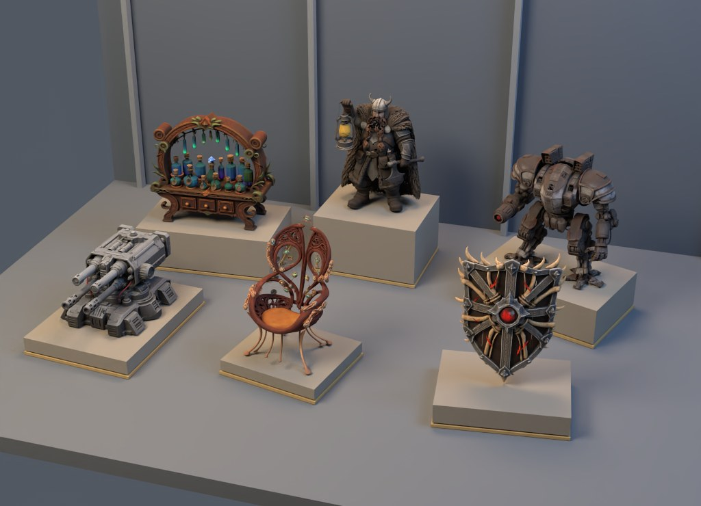
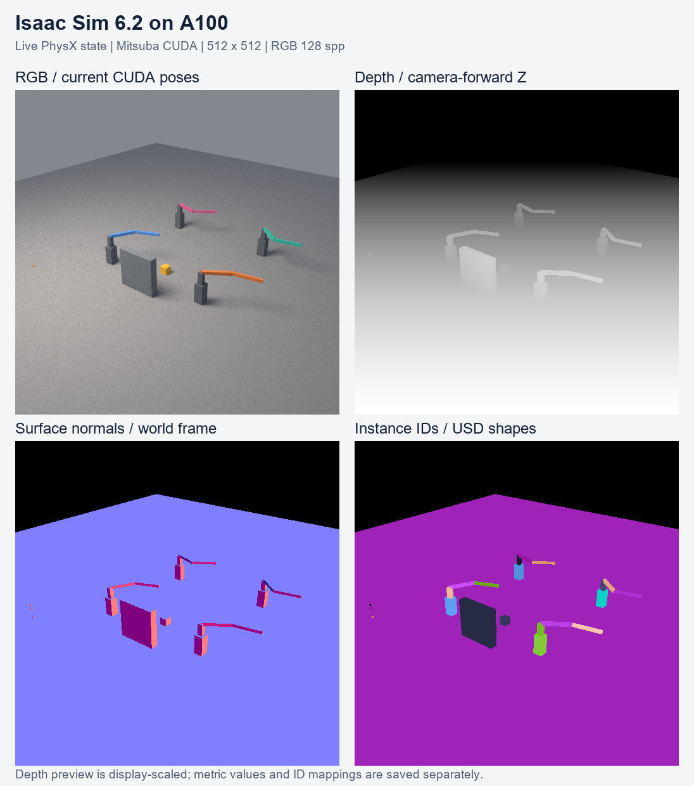

# IssacSim4A100

在 NVIDIA A100 上运行 **Isaac Sim 6.2 GPU PhysX 仿真 + Mitsuba/Dr.Jit CUDA 渲染**。

本仓库 fork 自 [isaac-sim/IsaacSim](https://github.com/isaac-sim/IsaacSim)，部署功能维护在 [`A100` 分支](https://github.com/EurecaMoment/IssacSim4A100/tree/A100)，基于官方 `v6.2.0` / `release/6.2`（`74a9356b20250dd60337d90b4b4d913c9454d32b`）。官方源代码和历史保留，原版说明见 [README.upstream.md](README.upstream.md)；当前部署的自定义代码、补丁、启动器、验证和资产处理示例集中在 [a100/](a100/)。

**A100 没有 RT Core，不满足官方完整 RTX 渲染器的硬件要求。** 本适配关闭 Kit 原生 RTX，保留 CUDA PhysX，以 Mitsuba/Dr.Jit 的 CUDA/OptiX 路径追踪渲染实时 USD 场景。它是已部署的服务适配，不代表完整 Isaac Sim 的所有功能均已移植到 A100。



*实际部署渲染结果；原始几何和大体积资产未随仓库分发。*

## 已验证的环境

下面是 2026-11-12 导出代码时的实际运行环境；其他 GPU、驱动和系统组合需要重新验证。

| 项目 | 当前配置 |
| --- | --- |
| GPU | A100-SXM4-80GB，单服务实例使用一张卡 |
| 宿主系统 | Linux x86_64，Ubuntu 20.04.6 |
| NVIDIA 驱动 | 535.161.08 |
| CUDA Toolkit | 12.2，默认 `/usr/local/cuda-12.2` |
| 隔离运行环境 | Ubuntu 24.04 Noble rootfs；用户命名空间 + bind mount + chroot |
| Python | uv 管理的独立 CPython 3.12 |
| Isaac Sim Python 包 | `6.2.0.0` |
| 已部署运行时的 VERSION | `6.2.0-rc.14+release.52805.02189a84.gl` |
| 渲染 | Mitsuba 3.9.1，Dr.Jit 1.5.0，variant `cuda_ad_rgb` |
| Python 主要依赖 | NumPy 2.3.1，Pillow 12.1.1，aiohttp 3.14.5，orjson 3.11.3 |

Python 包版本、运行时内部构建字符串和仓库源码 tag 是不同的版本信息，上表分别保留。Noble rootfs 提供较新的 glibc / C++ 运行库，不需要升级宿主系统。驱动库从宿主绑定，OptiX 用户态库从匹配版本的 NVIDIA 包中提取。

宿主需要 `bash`、`curl`、`tar`、`git`、`dpkg-deb`、`unshare`、`mount`、`chroot`、C/C++ 编译器、CMake ≥ 3.13 和 `uv`。建议预留至少 50 GB 磁盘空间；大网格场景还需要相应的内存和显存。后台常驻另需可用的 systemd 用户服务。

先检查 GPU 和用户命名空间：

```bash
nvidia-smi
unshare -Ur -m true
```

如果第二条被宿主策略禁止，需要管理员允许用户命名空间，或提供等效的容器运行环境。仓库当前的启动脚本面向原生 Linux，Windows 不直接运行这些服务。

## 功能范围

2026-11-12 已扩展并实测以下功能。**“服务”表示已接入独立常驻接口；“脚本”表示已在当前 A100 上运行验证，但没有对应 HTTP 动作；安装了扩展不等于功能已经通过。** 原有三个服务保持运行，新增服务默认在 `127.0.0.1:8322`。

| 能力 | 当前 A100 部署的实际状态 |
| --- | --- |
| CUDA 刚体物理、GPU broadphase、TGS | 服务；强制 CUDA，支持方块、球和 mesh 刚体 |
| 动态 mesh 碰撞 | 服务；使用 convex hull，不等同于任意动态凹网格 |
| USD 场景编辑、引用与导出 | 服务 / 脚本；可保存物理状态、机器人和动画 |
| RGB、统一布光、多资产场景 | 服务；Mitsuba/Dr.Jit CUDA/OptiX，mesh 和自定义 Gaussian 路径 |
| 深度、距离、表面法向 | 服务；自定义 CUDA 主射线标注，米制 Z-depth / range、世界坐标法向 |
| 实例 ID、语义 ID、有效像素 mask | 服务；显式 USD 标签和形状到 prim 的映射；不做自动语义识别 |
| 机器人位置 / 速度 / 力矩控制 | 服务；真实 PhysX articulation，4 个双关节机械臂分别控制 |
| 多环境 / 多机器人克隆 | 服务；官方 GridCloner，支持 1–16 个演示机械臂，当前 4 个 |
| Jacobian、质量矩阵、关节作用力 | 服务；从真实 CUDA articulation tensors 读取 |
| IMU、接触、JointState、Effort | 服务；官方物理传感器，已核对重力与支撑力 |
| 物理 RaycastSensor | 服务；三束已知距离测量及 180 束平面扫描 |
| 抓取、抬升、释放 | 服务；自定义 PhysX fixed-joint 吸附演示，先查询实际碰撞表面 |
| 官方 Surface Gripper | 扩展已加载；close 调用成功但尚未抓住测试物体，未判定根因 |
| 关节轨迹生成与执行 | 服务；官方最短时间轨迹生成器，已检查实际机器人到达终点 |
| 差速控制器 | 服务；官方控制器输出已验证；该动作只计算轮速，没有生成轮式机器人 |
| ROS 2 Jazzy / FastDDS | 服务；官方 bundled rclpy + 自定义数据桥，收发及实际机械臂控制通过 |
| ROS 2 JointState / IMU / LaserScan / Clock / TF | 服务；5 个发布 topic 和 1 个关节命令订阅 topic |
| URDF → USD、MJCF → USD | 脚本；关节与 articulation 保留，导入后 CUDA 目标跟踪通过 |
| USD → URDF、Heightmap、资产检查 / 优化工具 | 相应扩展随 asset 包安装；未逐项完成转换、优化或验收 |
| Gain Tuner 核心 | 脚本；机器人标记补全后可发现两关节并计算有效惯量；GUI 和自动调参未验收 |
| Newton 1.6.1 XPBD 刚体 | 脚本；Kit 内 CUDA 求解，读取直接 Warp state，关闭 CUDA graph |
| Newton XPBD 布料 | 服务；独立 CUDA Newton 模型，固定点和自由粒子运动通过，导出 USD 动画 / NPZ |
| 批量 observation / reward step | 服务；`rl_step` 提供基础批量数据，尚无训练算法 |
| Isaac Lab / 完整强化学习训练 | 独立框架尚未安装和适配；安装 `isaacsim-rl` 元包并不提供训练能力 |
| IK、RMPflow、cuMotion、Pink、机器人策略回放 | 需要对应规划依赖、机器人描述和策略；当前未验收，不列为可用服务 |
| 官方原生 RTX 相机、RTX LiDAR / Radar | A100 无 RT Core；当前关闭原生 RTX，不能以物理射线扫描替代并声称等价 |
| Replicator 图像标注与标准 writer 管线 | 当前未启用；自定义标注不是 Replicator，不能直接代替其全部接口 |
| 完整官方 ROS OmniGraph bridge / ROS control | 当前未启用；官方 ROS core 的扩展依赖包含 RTX / Replicator 链 |
| 完整 PBR、MDL、透明材质网络 | 当前顶点颜色适配未完整实现 |
| PhysX 体积软体、流体 / 粒子、触觉、车辆动力学 | 当前未逐项实测或接入；布料演示不代表这些能力已启用 |
| GUI、WebRTC 交互视口、NuRec | 当前无图形设备适配或对应模型 / 运行环境，未启用 |

扩展清单及数值证据见 [feature-validation.json](a100/research/feature-validation.json) 和 [extension-inventory.json](a100/research/extension-inventory.json)。清单包含扩展依赖以及独立机器人探测进程实际加载的扩展；不是“所有已安装扩展都在运行”的声明。



*RGB 使用 128 spp；标注为每像素中心单射线。深度预览做了显示归一化，米制原始值保存在 NPZ。*

资产视觉目前使用**顶点颜色**。FastTrellis GLB 中的 base-color 纹理可以按原始 UV 采样并烘焙到顶点，保留几何；metallic/roughness 贴图、透明材质和复杂材质网络不会完整还原。没有关节和碰撞定义的普通 mesh，也不会自动成为可控制的机器人。

## 安装

### 1. 获取代码并配置

适配服务不依赖官方示例的大型 LFS 资产，可先跳过这些下载：

```bash
GIT_LFS_SKIP_SMUDGE=1 git clone --branch A100 https://github.com/EurecaMoment/IssacSim4A100.git
cd IssacSim4A100/a100
uv python install 3.12
cp .env.example .env
```

编辑 `.env`：

```bash
ISAAC_GPU=0
A100SIM_CUDA_ROOT=/usr/local/cuda-12.2
A100SIM_DRIVER_VERSION=535.161.08
```

`ISAAC_GPU` 是 `nvidia-smi` 的物理编号或 GPU UUID；原部署使用物理编号 2，新机器应自行选择。`serve.sh` 会解析为 UUID，可用 `A100SIM_EXPECTED_GPU_UUID` 进一步固定卡的身份。隔离后 CUDA 内部显示 `cuda:0`，不代表选择了宿主物理 0 号卡。

Python 默认由 `uv python find 3.12` 查找。如果未正确找到，把 `A100SIM_PYTHON` 设置为用户目录中 uv 管理的 **Python 3.12 绝对路径**。请使用独立 Python，不要直接混用 Conda 中的 Isaac、CUDA 或渲染包。

安装和使用 NVIDIA 运行时须接受 [Isaac Sim additional software and materials license](https://www.nvidia.com/en-us/agreements/enterprise-software/isaac-sim-additional-software-and-materials-license/)。确认接受后，在 `.env` 保留 `OMNI_KIT_ACCEPT_EULA=YES`。

### 2. 准备运行环境

```bash
bash prepare.sh minimal
bash install-libs.sh
bash get-driver-libs.sh
bash build-drjit.sh
```

各步作用：

1. `prepare.sh minimal` 下载 Ubuntu Noble rootfs、固定版本的 Isaac 包和 Python 依赖，并通过 HTTP Range 提取 PhysX 所需的 Kit 扩展依赖。下载记录保存在 `downloads/physics-extensions.json`，未解析的必要扩展会报错。
2. `install-libs.sh` 在 rootfs 中下载并解压系统库，不修改宿主安装的软件包。
3. `get-driver-libs.sh` 只提取匹配驱动版本的 NVIDIA 用户态库，提供 `libnvoptix.so.1`，不安装或更换宿主驱动。默认下载地址已按 535.161.08 配置；其他版本可通过 `A100SIM_NVIDIA_DEB_URL` 指定匹配的官方 Debian 包。
4. `build-drjit.sh` 固定 `drjit-core` 到 `3b96411288b9938889045308654ba37d4ef24b71`，应用 [A100 补丁](a100/patches/drjit-core-a100.patch)，编译并替换渲染环境中的 `libdrjit-core.so`，保留 `.original` 备份。

补丁包含 R535 OptiX JIT 所需的 PTX `copysign` 位运算实现，以及旧 GCC 的 x86_64 Linux 线程指针兼容修改。不要只安装原版 Mitsuba wheel 后漏掉这一步；重新安装 Dr.Jit 后也需要重新应用已编译的库。编译使用 `-march=native`，应在部署机器上完成。

需要完整官方 Kit 扩展缓存时，可将第一步改成 `bash prepare.sh full`，下载量会显著增加。这不会自动启用原生 RTX 或新增 HTTP 功能。

如果已有运行环境，可以在 `.env` 设置 `A100SIM_ROOT=/absolute/runtime/path` 复用 `packages/`、`rootfs/`、`render-packages/` 和 `http-packages/`。代码仍从当前 `a100/` 加载。资产若在运行目录外，要设置 `A100SIM_ASSET_ROOT`；所有提交的资产目录都必须位于该根目录内，且不能通过符号链接越界。

### 3. 做一次 GPU 验证

```bash
bash run-physics-fixed.sh scripts/smoke_gpu.py --output "$PWD/results/smoke"
```

成功时打印 `A100_GPU_SMOKE_SUCCEEDED`，产生 `render.png`、`scene.usdc` 和 `simulation.json`。应看到 `physics_device: cuda:0`，渲染后端为 CUDA，且没有启用 `omni.hydra.rtx`。原部署的 64 方块物理验证也保留在 `physics_smoke.py`。

这些脚本来自已运行的部署；新的安装流程会从网络重建大体积运行时，而不是分发机器镜像。Ubuntu `current` 镜像和包源可能变化，可用 `A100SIM_ROOTFS_URL` 与 `A100SIM_ROOTFS_SHA256` 固定自己的 rootfs 快照。

## 启动与停止

### 前台运行

打开两个终端，在同一个 `a100/` 目录运行：

```bash
# 终端 1：通用物理与渲染后端
bash serve.sh generic
```

```bash
# 终端 2：批量仿真及请求分流前端
bash serve.sh resident
```

| 默认地址 | 用途 |
| --- | --- |
| `http://127.0.0.1:8321` | 统一入口、常驻队列、批量快速路径 |
| `http://127.0.0.1:18323` | 通用 GPU 场景仿真和渲染 |
| `http://127.0.0.1:8320` | 可选：固定资产的 mesh/Gaussian 渲染服务 |
| `http://127.0.0.1:8322` | 可选：机器人、物理传感器、自定义标注、ROS 2、Newton 布料 |

预加载资产服务不是启动核心服务的必要条件。只有需要它时，设置 `.env` 中的 `A100SIM_RENDER_ASSET=/absolute/path/to/prepared/asset`，再运行 `bash serve.sh render`。mesh 需要 `mesh.npz`，Gaussian 需要符合服务约定的 `object.ply`；普通点云 PLY 不能直接替代 Gaussian 数据。

### systemd 后台常驻

```bash
bash install-systemd.sh
bash start.sh
curl --fail http://127.0.0.1:8321/health
curl --fail http://127.0.0.1:18323/health
```

`start.sh` 启用服务并等待就绪；配置了 `A100SIM_RENDER_ASSET` 时才启动第三个服务。健康检查应返回 `status=ready`、`cpu_fallback=false`、`native_rtx=false`。首次初始化和着色器编译可能需要较长时间。

```bash
systemctl --user status 'isaacsim-a100-*'
journalctl --user -u 'isaacsim-a100-*' -f
bash stop.sh
```

用户服务要在退出登录后继续运行，宿主需要为当前用户启用 linger，例如管理员执行 `loginctl enable-linger <username>`。在 Slurm 集群上还应遵守已有 GPU 分配方式，在获得 GPU 的节点和会话内启动；安装脚本不申请调度资源。

新服务名为 `isaacsim-a100-*`，不会自动替换原部署的 `isaacsim-gpu2-*`。旧的 `serve-gpu2.sh`、`start-gpu2.sh` 等入口保留为兼容别名。与已有服务共存测试时，用 `.env` 设置其他端口和 `A100SIM_STATE_ROOT` / `A100SIM_LOCAL_STATE`。

## 可选功能的安装与启动

先完成上面的基础运行环境安装，再执行：

```bash
# 从 a100/ 运行；下载固定版本官方包和带 SHA-256 的 Python 依赖
bash install-features.sh all

# 前台启动机器人、传感器及 ROS 2 数据桥
bash serve-features.sh
```

安装写入独立的 `${A100SIM_FEATURES_ROOT:-$A100SIM_ROOT/features}/packages`，不替换基础服务的包，不重启原服务。`all` 包括机器人、ROS 2、资产转换和 Newton；也可选择 `robotics`、`ros2`、`assets` 或 `newton`。这些 profile 都包含机器人公共依赖；`assets` 还安装 MuJoCo / Newton 转换所需依赖。`robotics` 不安装 ROS 2 时，启动前在 `.env` 设置 `A100SIM_FEATURE_ROS2=0`。没有 Newton 时健康检查不会列出 `cloth` 动作。

安装器固定 Linux x86_64 / CPython 3.12 wheel，使用 `--no-deps` 保留基础 NumPy。完整官方 wheel 和 Python 依赖校验 SHA-256；大型 Kit cache 仅按 [固定扩展计划](a100/research/feature-extensions.json) 做 HTTP Range 提取并检查 ZIP 完整性。当前部署通过离线下载与 overlay 安装完成；**全新机器从零下载的整套安装流程尚未端到端重建**。

后台运行：

```bash
bash install-systemd.sh
bash start-features.sh
curl --fail http://127.0.0.1:8322/health
journalctl --user -u isaacsim-a100-features.service -f
# 停止新增服务
bash stop-features.sh
```

新增单位与基础 `start.sh` / `stop.sh` 分开管理。当前 g3005 实例在已经分配的 Slurm allocation 内运行，服务寿命受该 allocation 约束；systemd 不会代为申请 GPU。不要只凭旧 systemd 单位的状态判断原服务是否在线，应同时检查对应 HTTP 健康接口。

### 机器人与传感器接口

```bash
python3 examples/feature_client.py '{"action":"snapshot"}'
python3 examples/feature_client.py '{"action":"command","mode":"position","targets":[0.6,-0.4],"steps":240}'
python3 examples/feature_client.py '{"action":"command","mode":"velocity","targets":[0.25,-0.15],"steps":30}'
python3 examples/feature_client.py '{"action":"command","mode":"effort","targets":[0.4,0],"steps":24}'
# 恢复位置保持，避免力矩命令继续生效
python3 examples/feature_client.py '{"action":"command","targets":[0.6,-0.4],"steps":240}'
python3 examples/feature_client.py '{"action":"dynamics"}'
python3 examples/feature_client.py '{"action":"scan"}'
python3 examples/feature_client.py '{"action":"gripper","operation":"cycle"}'
python3 examples/feature_client.py '{"action":"trajectory","points":[[0.6,-0.4],[0.3,-0.2],[0.1,0.2]]}'
python3 examples/feature_client.py '{"action":"capture","size":512,"spp":32}'
python3 examples/feature_client.py '{"action":"cloth","frames":90}'
```

HTTP 为 `POST /robotics`、`GET /jobs/<id>`、`GET /health`。只提交一次并查询原 job ID；只有 `state=succeeded` 表示成功。所有动作在拥有 Kit 的同一线程串行执行，避免并发修改 USD。默认队列容量 32，不提供任意代码执行入口，绑定 loopback。

单个 `[q1,q2]` 控制 `arm_index` 指定的机械臂，默认 0；N×2 数组同时控制全部 N 个。位置单位 rad、速度 rad/s、力矩 N·m；边界分别为 ±2.96、±5、±20，步数 1–1200。命令持续到被后续控制覆盖；ROS 开启时即使无 HTTP 请求，场景仍会继续步进。PhysX stiffness / damping 参数编辑使用 CPU buffer，目标、力矩和仿真在 CUDA；不能把整个控制链描述成“完全没有 CPU 操作”。

`capture` 保存实时场景的 `render.png`、`scene.usdc`、`render-annotations.npz`、`render-labels.json`，以及 depth / normals / instances 预览。NPZ 含 `depth_m`、`range_m`、`normal_world`、`instance_id`、`semantic_id`、`valid`。深度是相机前向 Z，range 是到相机中心的欧氏距离；未命中为 0，应结合 valid mask。标注采用像素中心单射线，不含 RGB 抗锯齿、多样本或运动模糊；ID 不保证跨场景编辑保持不变。语义读取 prim 或祖先的 `a100sim:semanticLabel` 字符串。当前只支持 mesh 标注，Gaussian 模式会拒绝该请求。

导出从真实 CUDA articulation / rigid-body tensors 读取世界位姿，写入独立 USD 副本后渲染。启用 GPU readback 抑制时，仅保存原始 USD 会留下初始姿态；验收脚本会逐个核对渲染使用的连杆平移及旋转与物理 tensor 一致。

`scan` 是物理碰撞几何上的 180 束二维扫描，不模拟 RTX LiDAR 的强度、波形、材质回波、多次回波或扫描时序。原生传感器的 `hit_positions` 位于传感器局部坐标系。

`gripper` 默认使用自定义 PhysX 约束吸附，不是官方 Surface Gripper 的成功替代实现声明。关闭前实际检查 2 cm 范围内的目标表面，随后创建约束、抬升并删除约束释放。`rl_step` 只返回批量观测、示例 reward 和终止标志，不执行优化器、策略训练或 Isaac Lab 工作流。

### ROS 2

默认使用 wheel 自带的 **Jazzy / rclpy / FastDDS**，不要求修改宿主 ROS 安装。默认 `ROS_DOMAIN_ID=80`、发现范围 `LOCALHOST`。外部主机通信需要在 `.env` 明确配置相同 domain 和网络发现，并重新启动新服务；当前只验收了同机收发。

| Topic | 类型 / 用途 |
| --- | --- |
| `/a100/joint_states` | `sensor_msgs/msg/JointState`，4 臂共 8 关节 |
| `/a100/imu` | `sensor_msgs/msg/Imu`，动态方块 IMU |
| `/a100/scan` | `sensor_msgs/msg/LaserScan`，180 束物理射线 |
| `/clock` | `rosgraph_msgs/msg/Clock`，仿真时间 |
| `/tf` | `tf2_msgs/msg/TFMessage`，world 到机械臂连杆及传感器 |
| `/a100/joint_commands` | 订阅 `JointState`，同一机械臂的两个关节命令 |

命令的 names 使用 `arm0/joint1`、`arm0/joint2`，可换序；position、velocity、effort 只能填其中一组两个值。多臂用 `arm1`、`arm2` 等。下面的示例使用已有 ROS CLI 环境；需与服务设置相同 domain 和消息类型：

```bash
ROS_DOMAIN_ID=80 ros2 topic pub --once /a100/joint_commands sensor_msgs/msg/JointState \
  '{name: [arm0/joint1, arm0/joint2], position: [0.45, -0.25]}'
```

这是新写的数据桥，借用官方 bundled ROS 库；并没有启用完整官方 `isaacsim.ros2.bridge`、OmniGraph sensor graph、ROS control 或任意机器人控制器管理。

### URDF、MJCF 与 Newton

```bash
# 提供最小双连杆资产，转换后可选做单关节 CUDA 运动检查
bash run-assets.sh examples/import_robot.py examples/robots/two_link.urdf \
  --output "$PWD/results/urdf" --physics-check
bash run-assets.sh examples/import_robot.py examples/robots/two_link.xml \
  --output "$PWD/results/mjcf" --physics-check

# Kit Newton XPBD：R535 下使用直接 Warp state
bash run-newton.sh examples/newton_xpbd.py --output "$PWD/results/newton"

# 独立 Newton CUDA 布料；不切换常驻机器人的 PhysX 引擎
bash run-features.sh -m a100sim.newton_cloth --output "$PWD/results/cloth" --frames 90

# 查看实际启用的扩展及 Gain Tuner 的有限范围检查
bash run-features.sh research/inspect_features.py --output "$PWD/results/feature-inspection.json"
```

转换器关闭 asset transformer，URDF 同时关闭多物理转换后处理；这些选项不影响此次简单机器人生成 PhysX articulation。`--physics-check` 只面向提供的单自由度 fixture，不应直接用于任意机器人。真实机器人还需要检查网格路径、比例、质量 / 惯量、碰撞、限位和驱动。USD 结果可能采用子层或引用，应保留整个输出目录。

Newton 需要在全局配置和 physics scene 上都选 XPBD，并禁用 CUDA graph。Newton tensor 扩展会为 SimulationManager 注册后端，但示例不执行当前驱动不兼容的 tensor GPU 查询，而直接读取 Newton Warp state。Newton/MuJoCo 默认路径当前报 CUDA driver 12.4+ 的条件图节点要求；部分官方 Newton tensor kernels 报 PTX toolchain 不受支持。这些是当前 R535 环境的实测限制，不是布料资产的问题，也不代表 A100 永远不能运行 Newton。

Newton 不会在运行中自动应用任意 USD 属性编辑；应按官方说明使用受支持的数据接口，或停止、编辑、重新初始化。布料是独立 Newton 模型，当前与 PhysX 机器人没有跨求解器双向碰撞耦合。其他布料、体积软体、流体或复杂抓取场景仍须单独验收。

可选 Kit 启动器默认使用 fast shutdown，部分异常后的 Kit 关闭仍可能使进程退出码为 0。示例验收应读取生成报告中的 `success` 和数值，不能只看退出码；外部 `benchmarks/validate_features.py` 检查失败会返回非零退出码。

### 本次实测与限制的来源

| 检查 | 实际结果 |
| --- | --- |
| 4 臂分别跟踪位置 | 最大误差约 `5.1e-6 rad` |
| 速度 `[0.25,-0.15]` | 约 `[0.2483,-0.1505] rad/s` |
| 施加 `0.4 N·m` | 原生关节传感器约 `0.4001 N·m` |
| 静止 IMU / 1 kg 方块支撑力 | 约 `9.81 m/s²` / `9.81 N` |
| 已知物理射线 / 扫描障碍 | `1.5 m` / `1.9 m` |
| 自定义吸附抓取 | 目标 Z 从 `0.02 m` 升到约 `0.25 m`，释放后回到 `0.02 m` |
| 深度标准场景 | 相机 Z=3、立方体顶面 Z=1，中心深度 `2.000 m`，法向 `[0,0,1]` |
| URDF / MJCF 导入后运动 | 目标 `0.3 rad`，实际约 `0.3000026` / `0.3000007 rad` |
| Kit Newton XPBD 落体 | 0.2 m 方块最终中心 Z=`0.099999 m` |
| Newton 布料 90 帧 | 221 粒子、384 三角形、13 固定点，固定点误差 0，自由点平均位移约 `0.576 m` |
| 常驻服务 / ROS 2 | 15 项端到端检查通过，含 CUDA 位姿与渲染一致性；5 topic 实际收取，并通过 ROS 2 改变真实关节状态 |

这些是小型验收场景的结果，不是所有资产、负载和机器人均达到相同精度或性能的保证。可复核的 JSON 报告保留数值和测试范围。

此前“没有开放”混合了三个原因：**部分功能只是原服务接口尚未接入**，此次已补上；**完整原生 RTX 是硬件限制**；**普通 FastTrellis 静态网格缺少机器人和物理定义是资产条件**。对于碰撞、质量、关节、语义和新 robot schema，资产仍需相应配置，不能靠安装扩展自动补齐。

官方 6.2 资料明确不支持没有 RT Core 的 A100 / H100，当前官方推荐驱动也高于此服务器的 R535。因此本仓库是已有环境上的定向适配，不是 NVIDIA 支持的完整原版配置。本次没有升级共享机器驱动或改动其他 GPU。完整 RTX / Replicator 图像工作流需要受支持的 RTX GPU 和驱动；完整训练还需独立安装、适配并验证 Isaac Lab。

参考依据：[6.2 硬件要求](https://docs.isaacsim.omniverse.nvidia.com/6.2.0/installation/requirements.html)、[6.2 release notes](https://docs.isaacsim.omniverse.nvidia.com/6.2.0/overview/release_notes.html)、[Newton 后端与限制](https://docs.isaacsim.omniverse.nvidia.com/6.2.0/physics/newton_physics.html)、[Physics RaycastSensor](https://docs.isaacsim.omniverse.nvidia.com/6.2.0/sensors/isaacsim_sensors_physics_raycast.html)。6.2 拆分了许多库与 Kit 适配扩展，也移除了 Cortex；不能沿用旧版扩展名来判断功能是否缺失。

## 调用服务

从 `a100/` 提交带统一光照的方块和球体示例：

```bash
python3 examples/client.py examples/cube.json
```

客户端只提交一次，通过返回的 job ID 查询完成状态。只有 **`state=succeeded`** 才表示完成；排队、运行中或超时都不应通过再次提交同一请求来等待。

统一前端支持长轮询：

```bash
curl --fail -X POST 'http://127.0.0.1:8321/simulate?wait_ms=30000' \
  -H 'Content-Type: application/json' --data-binary @examples/cube.json
curl --fail 'http://127.0.0.1:8321/jobs/<job-id>?wait_ms=30000'
```

直接调用通用后端时使用普通轮询，不带 `wait_ms`：

```bash
python3 examples/client.py examples/cube.json --url http://127.0.0.1:18323 --wait-ms 0
```

请求包含 `bodies`、`steps`、`dt`、`gravity`、`ground` 和可选的 `render`。当前主要限制：1–256 个刚体、1–1200 步、正方形图像 64–1024 像素、1–256 spp，队列容量默认 64。方块使用 `size`，球使用 `radius`，mesh 使用服务端绝对 `asset` 目录；旋转是 `orientation_xyzw`。

`mesh.npz` 必须包含 `vertices`、`normals`、`faces`、`colors`。颜色是 0–1 RGB；存在 `colors_linear` 键时按线性颜色读取，否则由 sRGB 解码。细节见 [physics_service.py](a100/a100sim/physics_service.py) 的 `PhysicsQueue.prepare()`。

结果 JSON 返回服务器上的文件路径，HTTP 接口不承担任意文件下载。通用结果在 `results/physics-service/<id>/`；快速路径结果在 `${A100SIM_LOCAL_STATE}/jobs/<id>/`，默认 `/var/tmp/a100sim-<uid>/jobs/`，保留策略默认 24 小时或 4096 个已完成任务。首次重启发现的未完成通用任务会标为 `interrupted`，不会自动重跑。

## FastTrellis 多资产与统一布光

转换环境与服务分开安装。在服务器上准备自己的 GLB 文件后：

```bash
uv venv --python 3.12 .venv-assets
uv pip install --python .venv-assets/bin/python -r requirements-assets.txt
.venv-assets/bin/python examples/prepare_fasttrellis_assets.py /path/to/glb-or-directory \
  --output "$PWD/assets/fasttrellis" --source-up y --max-size 1.2
python3 examples/make_scene.py assets/fasttrellis/assets.json --output results/gallery --seed 20261112
python3 examples/client.py results/gallery/overview.json
python3 examples/client.py results/gallery/left-angle.json
python3 examples/client.py results/gallery/close-up.json
```

多个输入可以一次传入。转换保持完整网格，将 Y-up 转成 Z-up，按最长边归一化到 1.2 米，采样原始 base-color 纹理并记录原文件 SHA-256。已有 Z-up 资产用 `--source-up z`。

场景生成器按种子打乱顺序、轻微随机化位置和角度，组合展台、背景、暖色主光与冷色补光，并生成三个视角。零重力加一次 CUDA 物理步保留陈列位姿。原部署曾完成六个 FastTrellis 资产、约 565 万三角面的统一场景渲染；实际耗时依几何量、分辨率和 spp 而变。

可选的 [denoise_image.py](a100/examples/denoise_image.py) 使用另行安装的 OIDN 2 库对图像做 CPU 后处理。它不改变物理与光线追踪的 CUDA 执行路径，也不是核心启动依赖。

## 验证与性能

```bash
# Python 3.12；从 a100/ 运行，不需要 GPU
uv run --python 3.12 --no-project python -m unittest discover -s tests -v

# 已启动服务后的端到端检查与并发基准
mkdir -p results/performance
python3 benchmarks/validate_http.py
python3 benchmarks/validate_features.py --report results/performance/features.json
python3 benchmarks/gpu2_http.py --url http://127.0.0.1:8321 --concurrency 64 --rounds 3 --workload default \
  --report results/performance/benchmark.json
```

`benchmarks/` 的检查需要在可读取服务端结果路径的机器上运行；`validate_http.py` 包含 65 并发的队列压力检查，应在服务空闲时执行。`a100sim/validate_*` 是原部署的研究验证脚本，部分依赖历史基准报告，不属于全新安装的必跑检查。涉及外部资产的测试需要设置 `A100SIM_RENDER_ASSET`。快速路径最多 64 个环境、每环境最多 64 个 0.2 米方块，只有符合地面、相机、尺寸和采样等条件的请求会合批，其余场景分流到通用后端。详细条件见 [resident_service.py](a100/a100sim/resident_service.py)。

此次整理已在现有 A100 运行环境上验证迁移后的 CUDA 仿真、128px 渲染和 USD 导出，并执行独立的队列/路径测试、Shell 语法检查及 systemd 模板验证。全新机器上的完整依赖下载与安装尚未端到端重跑。

历史上曾在特定 64 并发方块负载中完成亚秒级响应；这不适用于任意 mesh 场景，也不是所有请求的延迟保证。基准应区分冷启动、预热、排队、GPU 计算和结果写盘。

## 常见问题

| 现象 | 排查方向 |
| --- | --- |
| glibc / GLIBCXX 版本错误 | 确认通过本仓库的 `run-*-fixed.sh` 启动；先完成 `install-libs.sh`。特殊环境可指定 `A100SIM_CXX_LIB_DIR` |
| 找不到 `libnvoptix.so.1` | 执行 `get-driver-libs.sh`，核对驱动版本与 `A100SIM_NVIDIA_ROOT` |
| OptiX JIT / PTX `copysign` 错误 | 检查 Dr.Jit 固定版本和补丁库，重新执行 `build-drjit.sh` |
| `asset must be ... under ...` | 使用服务端绝对目录，确保位于 `A100SIM_ASSET_ROOT` 内 |
| systemd 用户服务不可用 | 先用两个终端前台启动，检查用户会话和集群限制 |
| 端口冲突 | 调整 `.env` 的三个端口；前端会按配置连接通用后端 |
| 材质像塑料或细节丢失 | 当前顶点颜色渲染不完整复现源 PBR 材质；检查网格顶点密度和 base-color 转换 |

## 源码与许可

`a100/source-manifest.json` 保存整理前部署源码的 SHA-256 和版本来源，便于追溯。源码经过路径、设备、端口、安装与启动配置的迁移整理；它不是整台服务器的镜像。

本仓库保留官方 [LICENSE](LICENSE) 与 [THIRD_PARTY_NOTICE.md](THIRD_PARTY_NOTICE.md)。新增适配代码按 Apache-2.0 提供。Isaac Sim / Omniverse Kit 运行时、NVIDIA 驱动组件、Mitsuba、Dr.Jit、OIDN 及模型资产分别遵循各自许可。Dr.Jit 补丁基于 [mitsuba-renderer/drjit-core](https://github.com/mitsuba-renderer/drjit-core)；`a100/research/` 中 NVIDIA 源码保留其原版权声明。

大型运行时二进制、rootfs、wheel、模型权重、生成资产、作业结果及本机配置均由 `.gitignore` 排除，按上面的步骤在部署机获取。
